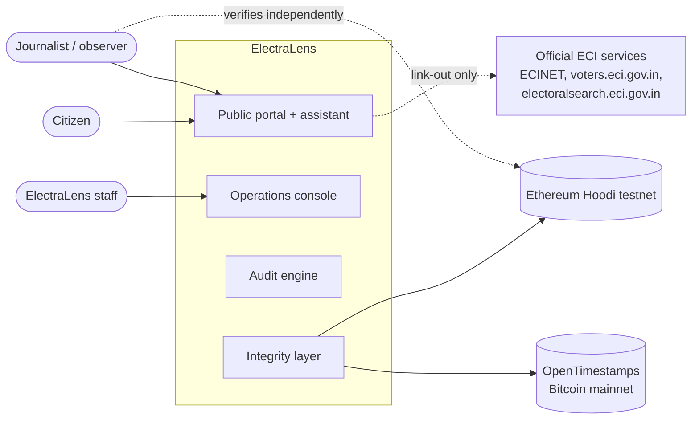
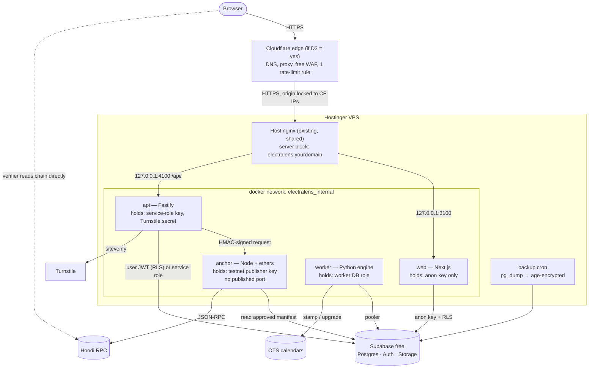
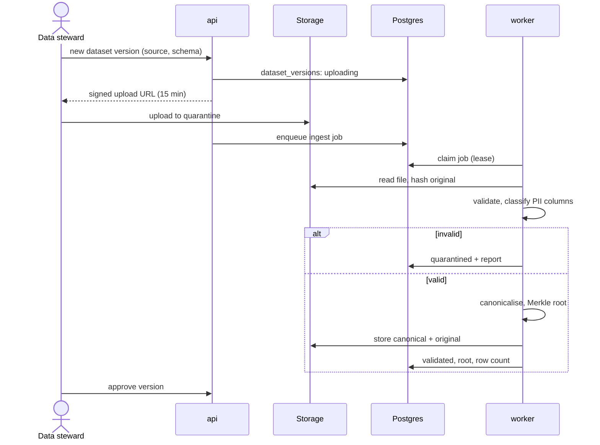
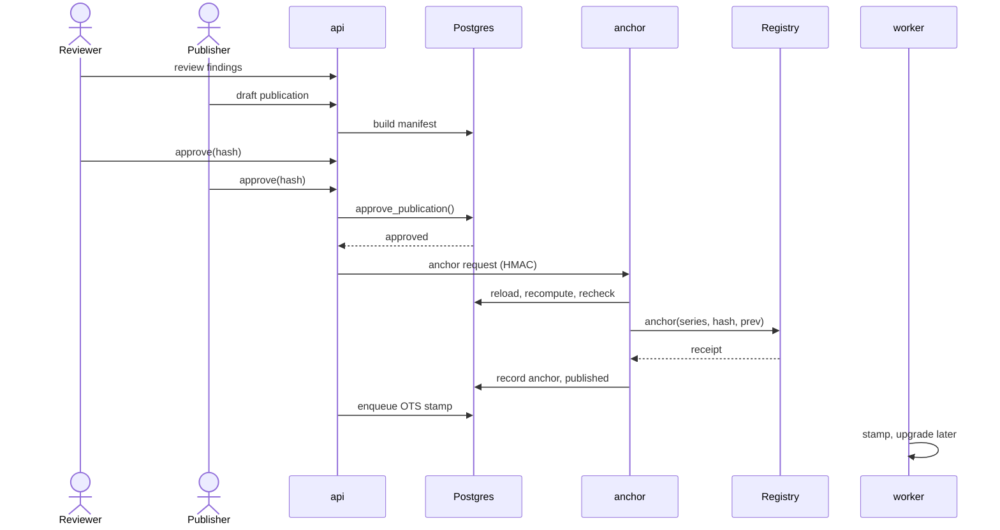
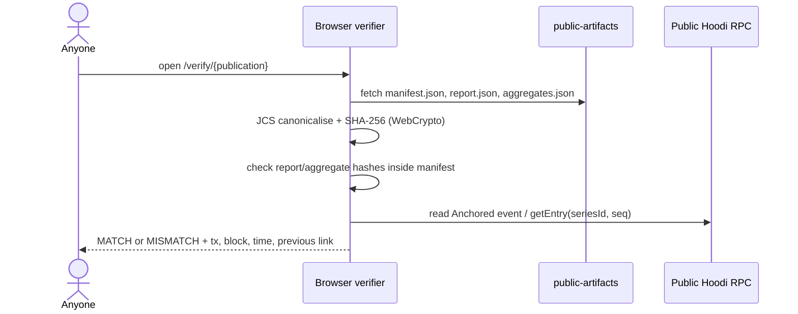
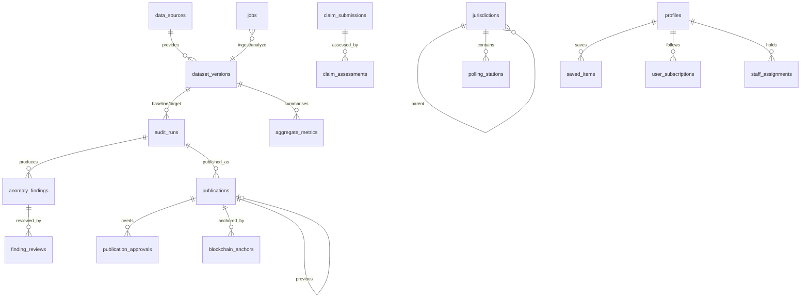

# ElectraLens — System Architecture

Version 0.1 · 2026-10-27 · Draft for approval. Conventions ([V]/[A]/[P], IDs) as in [01-PRD.md](01-PRD.md).

## 1. Where ElectraLens fits in the electoral process

Different authorities control different stages of an Indian election. ElectraLens works on only two of them, the roll and voter information, and links out for everything official.

| Stage | Responsible | Legal basis | ElectraLens role |
|---|---|---|---|
| Roll preparation and revision (annual summary revision, intensive revision, SIR, continuous updating) | Chief Electoral Officer (state), District Election Officer, Electoral Registration Officer (ERO) per assembly constituency, Assistant EROs, Booth Level Officers (BLO) per part | Representation of the People Act 1950; Registration of Electors Rules 1960. Four qualifying dates (1 Jan, 1 Apr, 1 Jul, 1 Oct) since the 2021 amendment, effective 1 Aug 2022 [V] | **Core.** Version comparison, anomaly detection, explanations. |
| Claims and objections: Form 6 (inclusion), 7 (objection/deletion), 8 (correction/shifting), plus 6A and 6B | ERO decides. Appeals go to the District Magistrate, then the CEO [V] | RP Act 1950, RER 1960 | **Explain and link out.** Guide citizens to the official forms. Never file on anyone's behalf. |
| Announcement, Model Code of Conduct | ECI | Article 324; RP Act 1951 | None |
| Nominations, scrutiny, withdrawal | Returning Officer | RP Act 1951 | None |
| Campaign | Candidates and parties | MCC | None (neutrality) |
| Polling-station setup, voter information | DEO and RO; BLOs distribute voter information slips. Cap of 1,200 electors per station reinstated in 2025 [V, secondary sources] | ECI instructions | **Companion.** Booth pages from verified public data, QR posters. |
| Identity checks on polling day | Presiding and polling officers | Conduct of Election Rules 1961 | None. ElectraLens is never an ID. |
| Counting and results | RO and counting staff | RP Act 1951, CE Rules 1961 | None. No vote data is ingested. |

**Official services we link to, but don't integrate with.** ECINET, ECI's single app launched January 2026, which merges 40+ earlier apps including Voter Helpline [V, news]. Also voters.eci.gov.in and electoralsearch.eci.gov.in. I found **no documented public API** for electoral search or booth lookup. These portals are meant for interactive use, and automating them would bypass their bot protection, so we don't. Any integration needs ECI authorisation (P3).

## 2. Stack evaluation (zero-cost)

| Requested | Verdict | Why it's needed / what changes |
|---|---|---|
| Hostinger VPS | **Keep** | Already paid for. Runs all ElectraLens containers. It also serves your other app behind host nginx, so ElectraLens binds to localhost ports with its own nginx server block and memory limits. **VPS RAM and CPU are unknown [A]**: we need about 1.5 GB free. |
| Supabase free tier | **Keep, with mitigations** | Postgres, Auth and Storage without running them ourselves. Free-tier facts [V] and how we handle them: **no automatic backups** → our own nightly encrypted `pg_dump`. **Paused after 1 week of inactivity** → the worker polls every few seconds, plus a daily health query [A: that this counts as activity]. **500 MB database** → row-level data stays out of Postgres (§6). **1 GB storage** → enough for synthetic datasets. **2 free projects**, one taken by your other app → production is the second, and development runs on the local Supabase CLI in Docker. **Default email: 2 per hour, team members only** → custom SMTP on a free sender (Gmail app password or Brevo free). Custom Access Token hook and TOTP MFA are available on Free [V]. |
| Supabase Auth | **Keep** | Citizen OAuth and magic links, staff TOTP MFA, `aal2` checks inside RLS. |
| Cloudflare free | **Keep, conditional** | The free plan only supports **full setup**, meaning your whole domain's nameservers move to Cloudflare. Proxying just a subdomain needs Business [V]. Free gives one rate-limiting rule (10 s window) and the free managed WAF ruleset [V]. **Turnstile works without the proxy** (free, unlimited challenges, 20 widgets) [V]. See decision D3. |
| Next.js + TypeScript | **Keep** | Server rendering for fast, crawlable, low-JS public pages. One app with three areas: public, citizen, ops console. |
| Node.js backend | **Keep, as a separate Fastify service** | Next.js route handlers would put privileged keys inside the internet-facing web container. A separate API holds the service-role key, enforces authorisation, rate limits and audit logging, and gives one clear security boundary. Cost: one ~150 MB container. |
| Python analytics | **Keep** | Polars, SciPy and RapidFuzz make the rule engine and statistics straightforward. Runs as a queue worker, never inside web requests. |
| Solidity + EVM | **Keep, on the Hoodi testnet** | Append-only, publicly readable registry of publication hashes. ethereum.org recommends Sepolia for app development and Hoodi for validator testing [V], but Sepolia faucets couldn't fund fresh wallets in your earlier project and you already have Hoodi test ETH, so Hoodi is the practical choice. The network is a config value, so switching is cheap. |
| *(added)* OpenTimestamps | **Add** | Free, no API key, anchors hashes in **Bitcoin mainnet** through public calendars [V]. Testnets can be retired (Holesky was shut down in 2025 [V]), so this gives a durable second proof at zero cost. |
| SHA-256 | **Keep, plus canonicalisation** | RFC 8785 JSON canonicalisation and an RFC 6962-style Merkle tree (§8). Hashing raw CSV bytes is not enough. |
| Docker Compose | **Keep** | Separate compose project, its own network, resource limits. |
| *(added)* Postgres job queue | **Add instead of Redis** | `FOR UPDATE SKIP LOCKED` on a `jobs` table. No extra service, and jobs change state in the same transaction as their data. We poll because LISTEN/NOTIFY doesn't work through Supabase's transaction pooler. |
| *(LLM)* | **Optional, off by default** | No paid API (C1). Explanations come from reviewed templates, so they're deterministic, free and can't hallucinate. Optional adapters: Gemini API free tier (its 2026 limits changed several times, and free-tier prompts may be used to improve Google products [V, secondary]) or a small local model via Ollama if the VPS has spare RAM [A]. Only **public** evidence is ever sent. |

## 3. Context



## 4. Deployment



## 5. Components

| Component | Responsibility | Credentials it holds | Never does |
|---|---|---|---|
| **web** (Next.js) | Public portal, assistant, booth pages, browser-side verifier, citizen pages, ops console UI. Server-renders public pages with incremental revalidation. | Supabase URL and anon key | Hold the service-role key; write data directly |
| **api** (Fastify) | All writes and staff workflows. Turnstile validation, rate limits, audit logging, signed upload URLs, QR generation, claim evaluation, job enqueueing. | Service-role key (used only for system operations), Turnstile secret, HMAC key for anchor | Hold the chain key; run long analyses |
| **worker** (Python) | Ingestion validation, canonicalisation, Merkle roots, diffs, rules, statistics, template explanations, report generation, OpenTimestamps stamping and upgrading. | Dedicated Postgres role with narrow grants (P1; MVP uses the service role) | Serve HTTP; publish anything |
| **anchor** (Node, ethers v6) | Re-reads an approved publication, **recomputes the manifest hash itself**, checks the two approvals, sends `anchor()`, records the receipt. One transaction at a time, with nonce management. | Testnet publisher private key (a dedicated hot wallet, not your personal wallet) | Accept a hash from the caller; reachable from outside the Docker network |
| **Supabase Postgres** | System of record. RLS on every table. Workflow state machine in `security definer` functions. | — | — |
| **Supabase Auth** | Citizen OAuth and magic links. Staff email, password and TOTP MFA. Custom access token hook adds UI role hints. | — | Decide authorisation. Roles are always re-checked in tables. |
| **Supabase Storage** | `datasets-restricted` (private), `quarantine` (private), `public-artifacts` (public read, written only after publication). | — | — |
| **Host nginx** | TLS, security headers, routing, request size limits, `limit_req` fallback rate limits, origin lock. | TLS certificate | Serve ElectraLens files directly |
| **Cloudflare** | DNS, proxy, caching, free WAF, one rate-limiting rule. **Turnstile** for claim submissions and citizen sign-in. | — | — |
| **ElectraLensRegistry** (Solidity) | Append-only publication registry with role-based publishing. | Admin role = your MetaMask testnet wallet (offline). Publisher role = the anchor hot wallet. | Store anything but hashes and IDs; get upgraded |
| **Browser verifier** | Downloads the manifest and report, recomputes hashes with WebCrypto, reads the chain from a public RPC, shows match or mismatch. | — | Trust our API for the verdict |

## 6. Data tiers

| Tier | What | Where | Who can read |
|---|---|---|---|
| **R — Restricted** | Row-level roll data (synthetic in the MVP), dataset salts, row-level evidence (e.g. which two records look duplicated) | Private storage bucket, plus worker memory during a run | Worker; analysts and reviewers with `aal2` via short-lived signed URLs |
| **I — Internal** | Unpublished findings, review notes, ingestion reports, jobs, audit log, security events | Postgres, staff-only RLS | Staff by role and jurisdiction |
| **P — Public** | Approved aggregates (after suppression), published findings, methodology, manifests, anchors, booth data | Postgres with `published` RLS, plus the `public-artifacts` bucket | Everyone |

Moving data from I to P happens **only** through publication: two-person approval, small-cell suppression, and an automated PII scan (Threat model §5).

## 7. Data flows

### DF1 — Ingestion

The file goes straight to Supabase Storage and never passes through the VPS. The worker claims jobs with `SKIP LOCKED` and a lease, validates schema, ranges and references, and stores the canonical Parquet next to the original in `datasets-restricted`. Every step is written to `audit_log`. Steward approval of a version is P1.

### DF2 — Audit run
1. An analyst asks the API to run the audit on (baseline version, target version, methodology version). The API checks both versions are `approved` and enqueues `analyze`.
2. The worker loads both canonical files, diffs them, runs every rule on **every** part (FR-AUD-9), computes statistics with FDR control, and builds findings with evidence. Row-level evidence goes to restricted storage. Aggregate evidence goes to Postgres.
3. The worker renders explanations from templates in all three languages and records the code version, image digest, parameter hash and output hashes.
4. The run lands in `ready_for_review`. Nothing is public yet.

### DF3 — Review, publication and anchoring

- Reviewers accept, downgrade or reject each finding with a reason. The draft manifest contains only suppressed aggregates and the report, and its `manifest_hash` is what both people approve.
- `approve_publication()` checks the roles, MFA (`aal2`), that the two approvers are different people, and that neither created the run.
- The anchor service is called on the internal network with an HMAC. It reloads the manifest, **recomputes the hash itself**, rechecks the approvals, then calls `anchor(seriesId, manifestHash, expectedPrevious)` on the Hoodi registry. The receipt (transaction, block, log index) goes into `blockchain_anchors`.
- The OpenTimestamps proof is upgraded once Bitcoin confirms it, which takes a few hours.
- Approvals bind to `manifest_hash`. If anything changes after an approval, the hash changes and the approvals no longer match.

### DF4 — Independent verification (browser)

For synthetic datasets the canonical rows and salt are public too, so the verifier can rebuild the **dataset** Merkle root in the browser. For real restricted data, the public can verify reports and aggregates, and only authorised auditors can verify the dataset root (§8.5).

### DF5 — Tamper demo (synthetic only)
In demo mode, the judge edits one record in a copy of the published synthetic dataset. The verifier recomputes the root, gets a different value, and highlights the mismatch next to the original anchor transaction. With an inclusion proof it also shows **which leaf** changed.

### DF6 — Claim check
1. A user fills in the structured form, or free text is parsed into it by the LLM and confirmed by the user (P1). Turnstile is validated server-side.
2. The API maps the claim to a published aggregate query (area, metric, period).
3. Code computes the verdict with a stated tolerance: *Consistent* / *Contradicted* / *Disputed* (published sources disagree) / *Cannot be established*. Claims about intent or fraud always map to *Cannot be established*.
4. Templates render the explanation with the exact numbers and the manifest reference. If the user chose to submit the claim, it enters moderation. It is never auto-published.

### DF7 — QR booth page
QR → `https://<subdomain>/b/{public_code}`. `public_code` is a random 10-character base32 value with no meaning. The page is server-rendered from `polling_stations` (published only) and shows source, last verified time and official links. The QR is generated by the API as SVG. Nothing personal is in the URL, the page or the logs.

## 8. Integrity design

### 8.1 Canonicalisation (`elcanon-1`)
1. Parse against the declared schema. Reject unknown or missing columns.
2. Strings: Unicode NFC, trimmed, internal whitespace collapsed to a single space, empty becomes `null` for optional fields. No case folding, except code fields the schema marks as uppercase.
3. Integers as JSON numbers. Dates as `YYYY-MM-DD`. Enums by code.
4. Each row becomes a JSON object serialised with **RFC 8785 (JCS)**, then UTF-8 encoded.
5. Rows are sorted by their canonical bytes (lexicographic), so file order and line endings don't matter.

### 8.2 Commitment
- Leaf: `SHA-256(0x00 ‖ salt ‖ row_bytes)`. Node: `SHA-256(0x01 ‖ left ‖ right)`. Tree shape is the RFC 6962 Merkle Tree Hash. The 0x00 and 0x01 prefixes prevent second-preimage tricks.
- `salt` is 32 random bytes per dataset version, kept in Tier R. It stops anyone from guessing a person's row and confirming it through a published inclusion proof. For synthetic datasets the salt is published.
- Reports and aggregates are public JSON: `SHA-256(JCS(doc))`.

### 8.3 Publication manifest
```json
{
  "schema": "electralens.manifest.v1",
  "series_id": "DEMO-ST01-AC042",
  "sequence": 3,
  "previous_manifest_hash": "9f2c…",
  "is_synthetic": true,
  "datasets": [
    {"role": "baseline", "version_id": "…", "root": "…", "row_count": 184220, "schema": "electoral_roll_v1", "canon": "elcanon-1"},
    {"role": "target",   "version_id": "…", "root": "…", "row_count": 179954, "schema": "electoral_roll_v1", "canon": "elcanon-1"}
  ],
  "audit_run": {"id": "…", "engine": "git:<sha>", "image": "sha256:…", "methodology": "2026.1", "params_hash": "…"},
  "report_hash": "…",
  "aggregates_hash": "…",
  "published_at": "2026-11-02T10:15:00Z",
  "publisher": "ElectraLens (independent, not affiliated with ECI)"
}
```
`manifest_hash = SHA-256(JCS(manifest))`. **One on-chain transaction per publication.**

### 8.4 Registry contract (interface sketch, full code in Deliverable F)
```solidity
// Append-only. No update, no delete, no upgradeable proxy.
event Anchored(bytes32 indexed seriesId, uint256 indexed sequence, bytes32 indexed manifestHash, bytes32 previous, address publisher);
event Retracted(bytes32 indexed seriesId, bytes32 indexed manifestHash, bytes32 reasonHash, address publisher);

function anchor(bytes32 seriesId, bytes32 manifestHash, bytes32 expectedPrevious) external onlyRole(PUBLISHER_ROLE);
//   reverts if manifestHash was already anchored, or expectedPrevious != latest(seriesId) (no forks, no races)
function retract(bytes32 seriesId, bytes32 manifestHash, bytes32 reasonHash) external onlyRole(PUBLISHER_ROLE);
function latest(bytes32 seriesId) external view returns (bytes32);
function entry(bytes32 seriesId, uint256 sequence) external view returns (bytes32 manifestHash, bytes32 previous, uint64 timestamp, address publisher);
```
OpenZeppelin `AccessControl`. `DEFAULT_ADMIN_ROLE` stays in your MetaMask testnet wallet, never on the server. `PUBLISHER_ROLE` goes to the anchor hot wallet. If the server is compromised, you revoke the publisher role from MetaMask. Earlier entries can't be touched.

### 8.5 What goes on-chain, and what the chain does and doesn't prove

| On-chain | Off-chain |
|---|---|
| `seriesId` (synthetic area code), sequence, `manifestHash`, previous hash, publisher address, block time, retraction reason **hash** | Datasets, salts, reports, aggregates, findings, the reason text, all personal data |

**It proves:** whoever held the publisher key recorded hash *H* at block time *T*. Later entries can't silently change or remove it. Anyone can check that without trusting ElectraLens.

**It does not prove:** that the source data was authentic, complete or lawfully obtained; that the analysis was right; that the publisher was honest when publishing; that a testnet will exist forever (hence OpenTimestamps); or that restricted datasets match, unless an authorised auditor holds the data. Blockchain gives **consistency over time**, not truth.

## 9. Audit engine

### 9.1 Rule catalogue (thresholds are proposals, frozen per methodology version)

| ID | Check | Method | Default criterion [P] | Innocent explanations shown |
|---|---|---|---|---|
| R01 | Exact duplicate | Identical name, relative's name, age, gender and house number within a part (complete entries only; blanks are R10's concern) | Any match | Duplicate already pending deletion; re-registration after shifting; form entered twice |
| R02 | Likely duplicate | Same phonetic key (`phonetic_key_v1`) for name and relative's name, same gender, age difference ≤ 2, within a part. Jaro-Winkler was tried and rejected: spelling variants score 0.80–0.88 and different names 0.82–0.91, so no threshold separates them | Any pair. Labelled "possible" | Transliteration variants; similar names; family members |
| R03 | Impossible age | Age at qualifying date < 18 or > 110 | Any | Data-entry error; age from a different qualifying date |
| R04 | Age drift across versions | Same record, Δage ≠ elapsed years ± 1 | Any | Correction through Form 8; earlier error fixed |
| R05 | Deletion rate per part | Beta-binomial against a robust constituency baseline, Benjamini–Hochberg FDR. Transfers between parts are not deletions | q < 0.05 **and** rate ratio ≥ 2 **and** ≥ 20 deletions | House-to-house revision; migration or redevelopment; death-record catch-up; part reorganisation; duplicate clean-up |
| R06 | Addition rate per part | Same as R05 | Same | New housing; enrolment drive; first-time voters; part reorganisation |
| R07 | Part appeared or disappeared | Structural diff | Any | Polling-station rationalisation (e.g. the 1,200 cap) |
| R08 | High-occupancy address | Electors per normalised house number, compared with the constituency distribution | > p99.9 **and** ≥ 20 | Hostels, institutions, joint families, placeholder house numbers ("0", "NA") |
| R09 | Gender-ratio shift | Two-proportion test, FDR | q < 0.05 and \|Δ\| ≥ 50 per 1,000 | Targeted enrolment; small part size |
| R10 | Missing or invalid fields | Share of records per part, against the constituency | > p95 and ≥ 5 % | Data-entry quality in one batch |
| R11 | Deletion-reason mix | Binomial test per reason against the other parts of the constituency, Bonferroni over the four reasons, then FDR (chi-square was unreliable with small expected counts) | q < 0.05 and share ratio ≥ 2 and ≥ 20 deletions | Local death-registration or verification drive |
| R12 | 18–19 cohort shift | Compared with the expected cohort | q < 0.05 and rate ratio ≥ 2 | Enrolment camps near a qualifying date |

### 9.2 Statistics, signal strength and uncertainty
- Overdispersion is modelled (beta-binomial). The baseline rate is the pooled rate of the constituency's middle 50 % of parts, and the dispersion comes from the median absolute deviation of the residuals. Large parts don't fire on trivial differences, and a few extreme parts can't hide themselves by inflating the baseline.
- **FDR control** across thousands of parts (Benjamini–Hochberg), because testing many parts guarantees some false alarms. Every finding shows how many tests were run.
- A minimum effect size goes alongside significance.
- **Signal strength**, not "confidence of fraud": *Strong* (q < 0.001, rate ratio ≥ 3), *Moderate* (q < 0.01, rate ratio ≥ 2), *Weak* (q < 0.05, staff-only), *Data-quality notice*. Each comes with the observed value, the expected value, a 95 % Wilson interval and the q-value.
- The methodology page states plainly: *"Signal strength says how unusual a pattern is compared with similar areas. It is not the probability that anything improper happened."*

### 9.3 Explainability output (per finding)
```json
{
  "finding_id": "F-2026-000123",
  "rule": {"id": "R05", "version": "1.0.0", "name_key": "rule.R05.name"},
  "datasets": {"baseline": "…", "target": "…"},
  "area": {"level": "part", "code": "DEMO-ST01-AC042-P047"},
  "evidence": {"deletions": 212, "electors_baseline": 1180, "rate": 0.1797, "rate_ci95": [0.159, 0.202],
               "expected_rate": 0.061, "rate_ratio": 2.95, "q_value": 0.0004, "tests_in_run": 2140},
  "baseline": {"type": "constituency_parts", "n_parts": 286, "method": "beta_binomial"},
  "criterion": "q<0.05 AND rate_ratio>=2 AND deletions>=20",
  "signal_strength": "moderate",
  "explanation": {"en": "…", "hi": "…", "xx": "…"},
  "alternative_explanations": ["alt.house_to_house", "alt.migration", "alt.part_reorg"],
  "limitations": ["lim.synthetic_data", "lim.no_reason_codes"],
  "review": {"status": "accepted", "reviewed_at": "…"},
  "label": "analytical_finding"
}
```

### 9.4 Reproducibility and measuring detection quality
- Polars, sorted inputs, a fixed seed and pinned dependencies. Outputs are hashed. A CI "golden run" fails if output hashes drift without a methodology version bump.
- The synthetic generator writes a **ground-truth file** of injected anomalies. A benchmark job computes precision and recall per rule, and they go on the methodology page (FR-AUD-7). This is also how we decide whether ML is worth adding (FR-AUD-8).
- **Measured so far** (methodology 2026.1, seeds 42, 7 and 2026, about 110,000 electors each): every injected anomaly found, no false positives, no negative control violated. This is an easy test: the injected patterns are 2–5 times the normal rate, and the generator never creates two indistinguishable people in one part. Real data and subtler patterns will be harder, and the methodology page says so.

## 10. Authentication and authorisation

### 10.1 Who signs in how
- **Public:** no account.
- **Citizen:** Supabase Auth with Google OAuth or an email magic link (custom free SMTP). Turnstile on sign-in. Only a profile row is stored. **No EPIC number anywhere.** EPIC numbers are printed on cards and shared openly, so they are identifiers, not secrets.
- **Staff:** invite-only. A system admin invites through the API, which uses the service role to create the user and an assignment. Email + password (≥ 14 characters) + **mandatory TOTP**. Public signup can never create a staff role, because roles live in `staff_assignments`, which only the admin workflow writes.

### 10.2 Role matrix

| Capability | steward | analyst | reviewer | publisher | auditor | sysadmin |
|---|:-:|:-:|:-:|:-:|:-:|:-:|
| Upload or approve dataset versions | ✔ | | | | | |
| Run audits, view restricted evidence | | ✔ | ✔ (read) | | | |
| Review findings | | | ✔ (not own run) | | | |
| Approve publication — review step | | | ✔ | | | |
| Approve publication — publish step, retract | | | | ✔ (not own review) | | |
| Manage booth data | ✔ | | | | | |
| Read audit log and security events | | | | | ✔ | ✔ |
| Invite staff, assign or revoke roles | | | | | | ✔ |

One person may hold several roles in a small team, but **the database requires distinct people** for run creator, reviewer approval and publisher approval on the same publication.

### 10.3 How RLS and the API work together
1. **RLS is the floor.** Every table has RLS enabled. Anonymous users get `select` on published rows only. Staff policies call `security definer` helpers such as `el.has_role(role, jurisdiction)` that read `staff_assignments` **and** require `auth.jwt()->>'aal' = 'aal2'`. Revoking a role therefore works on the next query, not when the token expires. JWT role claims from the hook are UI hints only.
2. **The API is the front door.** It checks role and MFA again for clear errors, applies rate limits and Turnstile, and writes the audit log. For user actions it calls Supabase **with the user's JWT**, so RLS applies as well. The service role is used only in a few named system functions (invites, job state, publication assembly).
3. **Workflow transitions are database functions** (`approve_publication`, `retract_publication`, `review_finding`). Each checks the state machine and separation of duties and writes `audit_log` in the same transaction, so no client, including our own API, can skip a step.
4. **Sessions:** web uses `@supabase/ssr` httpOnly cookies. Calls to the API carry a bearer token, so they aren't exposed to CSRF. Staff sessions use short idle timeouts in the UI. Login abuse is handled by Supabase Auth rate limits, Turnstile, and `security_events` logging with alerts.

## 11. Data model (refined from the brief)



How this differs from the brief's list, and why:

| Brief | Decision |
|---|---|
| `ingestion_jobs`, `analysis_jobs`, `publication_jobs` | One `jobs` table with `kind`. Same queue logic, less code. |
| `source_manifests` | Covered by `data_sources` + `dataset_versions` (provenance) and `publications.manifest` (the published manifest). |
| `staff_roles` | A Postgres enum. Roles are fixed by the design, and assignments live in `staff_assignments`. |
| `review_actions` | `finding_reviews` for findings. Every other action goes to `audit_log`. |
| `saved_reports` | `saved_items` (reports **and** booths). |
| `retention_policies` | A versioned config file plus a scheduled job, published on the privacy page. A table would add nothing. |
| *(new)* `publications` | The manifest, status machine and previous-version link. The centre of governance. |
| `security_events`, `incident_records`, `audit_log`, `claim_*`, `blockchain_anchors` (EVM and OTS via `anchor_type`) | Kept. |

Full SQL, constraints, indexes, RLS and pgTAP tests come in Deliverable C.

## 12. API surface (overview, full contracts in Deliverable D)

All routes under `/api/v1`. Errors use RFC 9457 `application/problem+json`. Requests and responses are validated with shared schemas.

- **Public:** `GET datasets`, `GET datasets/{id}/summary`, `GET comparisons?baseline=&target=`, `GET findings`, `GET findings/{id}`, `GET methodology/{version}`, `GET publications`, `GET publications/{id}/manifest`, `GET verify/{id}` (convenience only, since the browser verifier doesn't need it), `GET booths/{code}`, `GET booths/{code}/qr.svg`, `POST claims/check` (Turnstile, rate-limited), `GET official-links`.
- **Citizen:** `GET/PATCH me`, `GET/POST/DELETE me/saved`, `GET/POST/DELETE me/subscriptions`, `DELETE me`.
- **Staff** (JWT + `aal2` + role): `POST staff/datasets`, `POST staff/datasets/{id}/approve`, `POST staff/runs`, `GET staff/runs/{id}`, `POST staff/findings/{id}/review`, `POST staff/publications`, `POST staff/publications/{id}/approve`, `POST staff/publications/{id}/retract`, `POST staff/users/invite`, `PUT staff/users/{id}/roles`, `GET staff/audit-log`, `GET staff/security-events`, `GET staff/jobs`, `POST staff/booths/import`.
- **Internal:** anchor `POST /internal/anchor` (Docker network only, HMAC with timestamp and nonce).

## 13. Trust boundaries

| ID | Boundary | Control |
|---|---|---|
| TB1 | Internet → edge | Cloudflare WAF, rate limits, Turnstile |
| TB2 | Edge → VPS | nginx accepts only Cloudflare IPs for this host. TLS Full (strict). |
| TB3 | nginx → containers | Ports bound to 127.0.0.1. Body size limits. |
| TB4 | api → anchor | Internal network only. HMAC. Anchor re-validates everything. |
| TB5 | Services → Supabase | Credentials split: anon (web), user JWT and service role (api), worker role (worker) |
| TB6 | Restricted/internal → public | Publication gate: two-person approval, suppression, PII scan |
| TB7 | ElectraLens → chain and OTS | Public and permanent. Hashes and IDs only. |
| TB8 | ElectraLens → LLM provider | Public evidence only, output validated, template fallback |
| TB9 | Browser verifier vs our server | The verifier reads the chain directly and doesn't trust our API |
| TB10 | ElectraLens vs the other app on the same VPS | Separate compose project, network, Unix user, directories, secrets and resource limits |

## 14. Failure handling

| Failure | Behaviour |
|---|---|
| Supabase unreachable or paused | Public pages serve cached copies with a "data as of …" banner. Writes fail closed. Alert. |
| Worker crash mid-job | Lease expires and the job is retried (max 3, idempotent by input hashes), then dead-lettered with an alert. Outputs are staged and committed in one transaction, never half-published. |
| Analysis too slow or too big | Container memory and time limits kill it, the job is marked failed, nothing is published. |
| RPC down or transaction stuck | Publication shows "integrity anchor pending". Anchor retries with backoff and bumps the fee on replacement. Alert after 1 hour. |
| Testnet retired or reset | OpenTimestamps proofs remain valid. History is re-anchored on a new network with a migration manifest that cites the old transaction hashes. |
| OTS calendar down | Several calendars are used. Upgrade retried later. |
| LLM unavailable, rate-limited or output rejected | Template text (always available). |
| Turnstile unavailable | Claim submission pauses (fail closed). Reading is unaffected. |
| Malformed or malicious upload | Quarantine plus ingestion report. Parser in a non-root, read-only container. |
| Unauthorised on-chain anchor | A reconciliation job compares chain events with approved publications and raises a critical alert (Threat model T16). |
| Traffic spike | Cached public pages at the edge, API rate limits, claim checks queued. |
| VPS disk filling | Docker log rotation, alert at 80 %. |

## 15. Deployment on the VPS

- Path `/opt/electralens`, compose project `electralens`, separate Unix user, completely apart from the other app.
- Services `web`, `api`, `worker`, `anchor`: `restart: unless-stopped`, healthchecks, `mem_limit` and `cpus`, non-root, `read_only: true` with tmpfs `/tmp`, `cap_drop: [ALL]`, `no-new-privileges`. Only web (3100) and api (4100) publish ports, both on **127.0.0.1**. The other app uses 8080/8443, so these don't clash.
- Secrets in Docker `secrets:` files (`chmod 600`). Each service gets only its own: web never sees the service-role key, and only anchor has the chain key. No secrets in Git or in `NEXT_PUBLIC_*` variables.
- Host nginx: a new `electralens.conf` server block with TLS (Let's Encrypt via certbot, or a Cloudflare Origin CA certificate), HSTS, CSP, `X-Content-Type-Options`, `Referrer-Policy`, `Permissions-Policy`, `client_max_body_size 1m` (uploads go straight to Supabase Storage), `limit_req` zones, and the Cloudflare IP allow-list **for this server block only**. The other app's configuration is untouched.
- **Backups:** nightly `pg_dump` (custom format, client version matching Supabase's Postgres major [A]) → encrypted with `age` to a public key whose private key lives **off** the VPS → 14 daily and 8 weekly copies kept → weekly copy pulled off the VPS (decision D7). Monthly restore drill into the local Supabase CLI. Synthetic datasets can be regenerated from their seeds.
- **Monitoring:** `/healthz` and `/readyz`, container healthchecks, a free external uptime monitor, job-failure and reconciliation alerts by email (and optionally a Telegram bot).
- **CI/CD:** GitHub Actions runs lint, typecheck, unit tests, Python tests, contract tests, RLS tests (local Supabase in CI), cross-language canonicalisation vectors, the PII scan, and image builds tagged by Git SHA. Deploy is SSH → pull tag → `docker compose up -d`. Migrations are applied manually and are additive only (expand, migrate, contract).
- **Rollback:** `IMAGE_TAG=<previous> docker compose up -d`. Because migrations are additive, rolling back the app never needs a database rollback. Database restore is for disasters only.

## 16. Repository structure

```
electralens/
├─ apps/
│  ├─ web/          Next.js (App Router, TS): public portal, assistant, verifier, citizen pages, ops console
│  └─ api/          Fastify (TS): REST API, authz, Turnstile, rate limits, audit log, QR
├─ services/
│  ├─ engine/       Python: generator, canonicaliser, rules, stats, templates, reports, worker loop, OTS
│  └─ anchor/       Node + ethers v6: signer service (the only holder of the testnet key)
├─ packages/
│  ├─ canon/        TS canonicaliser + Merkle + manifest (shared by browser verifier and api)
│  ├─ schemas/      JSON Schemas → TS (zod) and Python (pydantic) types
│  └─ i18n/         en / hi / third-language catalogues and explanation templates
├─ contracts/       Hardhat project: ElectraLensRegistry.sol, tests, deploy scripts
├─ supabase/        migrations/, seed.sql (fictional), tests/ (pgTAP RLS tests), config.toml
├─ test-vectors/    canonicalisation vectors used by both Python and TS tests
├─ infra/           docker-compose.yml, nginx/electralens.conf, backup/, scripts/
├─ docs/
└─ .github/workflows/
```

Hardhat rather than Foundry: it's TypeScript-native, uses ethers (as the brief asks), and runs natively on Windows.
