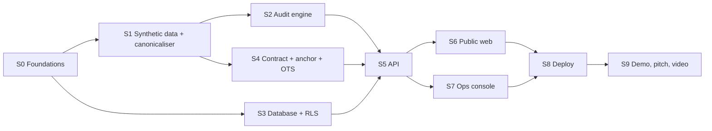

# ElectraLens — Implementation Roadmap

Version 0.1 · 2026-10-27 · Draft for approval. IDs refer to [01-PRD.md](01-PRD.md), [02-ARCHITECTURE.md](02-ARCHITECTURE.md) and [03-THREAT-MODEL.md](03-THREAT-MODEL.md).

## 1. Assumptions behind this plan

- The hackathon is **24 hours** and the result must be production-grade (PRD C7). The start time, team size, official judging criteria, and whether any code may be prepared before the clock starts are still **unknown** (decision D10).
- [A] VPS RAM and CPU are unknown. The plan needs about 1.5 GB free alongside the existing app.
- Zero spend (C1). Everything below runs on free tiers, open source or testnets.
- No code until you approve this plan and hand over the new repository.

## 2. Three horizons

| | **Hackathon MVP (24 h)** | **Zero-cost pilot** | **Institutional** |
|---|---|---|---|
| Data | Synthetic only, with injected anomalies and ground truth | Synthetic, plus officially published **aggregate** statistics after a legal check | Authorised data feeds under agreement |
| Engine | Deterministic rules R01–R12, FDR statistics, templates in 3 languages | Benchmarked ML only if it beats the rules; more rules from user feedback | Independent methodology audit |
| Integrity | Hoodi registry + OpenTimestamps, browser verifier, tamper demo | Reconciliation alerts, re-anchoring runbook | Mainnet or L2 anchoring with a multisig (**needs a budget**) |
| Accounts | Staff with MFA; citizen accounts optional (P1) | Citizen accounts, alerts, account deletion | Official SSO for officials, if ever offered |
| Booths | Synthetic booths, QR pages | Booth data from published official lists, with provenance | Official booth API, only with authorisation |
| Governance | Two-person publish, audit log | Second admin, auditor console, incident process | MoU with an election authority or recognised observer body |
| Ops | Live on the subdomain, nightly encrypted backups | Restore drills, uptime monitoring, an independent security test | SLA hosting, KMS or HSM keys, DPDP compliance programme |

## 3. Hackathon MVP stages (dependency-ordered)

S2, S3 and S4 can run in parallel once S1 is done, if you have teammates.

| Stage | Builds | Exit criteria |
|---|---|---|
| **S0 Foundations** | Monorepo skeleton (pnpm workspaces + Python project), local Supabase CLI, shared JSON Schemas, lint and format, CI skeleton, `.env.example`, licence and README | CI green on an empty test suite. `supabase start` works locally. |
| **S1 Synthetic data + canonicaliser** | Generator (state → district → AC → parts of ≤ 1,200 electors, Devanagari and Latin names, multiple versions, deletion reasons, injected anomalies with a ground-truth file, seeded). `elcanon-1` and the Merkle tree in **Python and TypeScript**. Shared test vectors. | **AC-7**. The same seed gives byte-identical datasets. |
| **S2 Audit engine** | Diff, rules R01–R06, R08, R10 (P0) and R07, R09, R11, R12 (P1), beta-binomial + FDR, findings schema, templates in en/hi/third language, report builder, benchmark job, worker loop with leases | **AC-2, AC-8, AC-9, AC-10** |
| **S3 Database + RLS** | Migrations for all tables in Architecture §11, enums, constraints, indexes, RLS, `security definer` workflow functions, append-only audit log, fictional seed, pgTAP tests | **AC-4, AC-5** |
| **S4 Contract + anchor + OTS** | `ElectraLensRegistry.sol` with Hardhat tests, Hoodi deployment script, anchor service (ethers v6, nonce handling, receipts), OpenTimestamps stamping and upgrading in the worker, reconciliation job | Contract tests pass (no overwrite, no duplicate, fork protection, role revocation). One demo manifest anchored on Hoodi and stamped with OTS. |
| **S5 API** | Fastify, auth middleware (JWT, `aal2`, roles), public, citizen and staff routes, Turnstile verification, rate limits, problem+json errors, audit logging, signed uploads, QR SVG, claim evaluation | Route × role authorisation tests. PII scan (**AC-3**). |
| **S6 Public web** | Dashboard, comparison, finding list and detail, methodology with benchmark, browser verifier + tamper demo, booth pages + QR, claim checker (structured), guided assistant, three languages, accessibility pass | **AC-1, AC-6, AC-11, AC-12** |
| **S7 Ops console** | Staff sign-in with TOTP, steward upload and approve, analyst run, reviewer review, publisher approve, retract, job status | The full DF1 → DF3 flow done through the UI by two different staff users |
| **S8 Deploy** | Compose with hardening, nginx server block, TLS, Cloudflare and Turnstile (per D3), Docker secrets, backup cron + one restore drill, uptime monitor, alerts | Live on the subdomain. The other app unaffected. Restore drill timed and documented. |
| **S9 Demo and pitch** | Live demo script, 5-minute talk outline, judge Q&A, 45–90 s video script, adoption slide (Deliverable I) | At least one full rehearsal on the live deployment |

### 24-hour schedule

Hours are counted from the start of the hackathon. Blocks overlap where work can run in parallel. The plan holds two fixed checkpoints: at **hour 12** the full flow must work locally end to end, even if it looks rough; at **hour 20** feature work stops.

| Hours | Work | Checkpoint |
|---|---|---|
| 0–1 | S0: repo skeleton, Supabase project and keys, local Supabase, CI | CI green |
| 1–4 | S1: generator with ground truth, canonicaliser in Python and TypeScript, test vectors | AC-7 |
| 3–8 | S2 engine (P0 rules, statistics, templates) · S3 database and RLS · S4 contract on Hoodi (in parallel) | AC-2, AC-4, AC-5, contract tests |
| 7–11 | S5 API: public and staff routes, auth middleware, Turnstile, anchor service | Route × role tests |
| 11–12 | **Checkpoint:** generate → audit → review → publish → anchor → verify, locally | Full flow works |
| 12–17 | S6 public web: dashboard, comparison, findings, methodology, verifier, tamper demo, booth + QR, claim checker, three languages | AC-1, AC-6, AC-11, AC-12 |
| 14–18 | S7 ops console (minimal screens for steward, analyst, reviewer, publisher) | DF1 → DF3 through the UI |
| 17–20 | S8 deploy: compose, nginx, TLS, Turnstile, secrets, backup cron, uptime check | Live on the subdomain |
| **20** | **Feature freeze.** Only fixes from here. | — |
| 20–22 | Full test pass on the live site, seed the demo data, rehearse | AC-1 on production |
| 22–24 | Video, pitch and judge Q&A (S9), buffer for surprises | Submission |

If the hour-12 checkpoint slips, apply the cut list below immediately rather than hoping to catch up.

### Mapping to your milestones and deliverables

| Your milestone | Stages | Deliverables |
|---|---|---|
| M1 Working audit engine | S1, S2 | E |
| M2 Public dashboard | S6 | G |
| M3 Blockchain anchoring | S1 (canon), S4, S6 (verifier) | F |
| M4 Database and authentication | S3, S5 (auth middleware) | C, D |
| M5 QR and booth information | S1 (synthetic booths), S6 | G |
| M6 Administration and review | S3 (workflow functions), S7 | D, G |
| M7 Production deployment | S8 | H |
| M8 Independent testing | Pilot phase (test plan in the threat model §4); automated parts start in S0 | — |
| — | S9 | I |

Deliverables A (PRD) and B (system design and threat model) are this set of documents.

### Cut list (cut in this order if time runs short)

1. LLM free-text claim parsing and LLM Q&A (FR-CLM-2, FR-AST-4)
2. Voice input and output (FR-AST-3)
3. Citizen accounts, saved items, alerts (M9 citizen parts)
4. OpenTimestamps (FR-INT-4)
5. Rules R07, R09, R11, R12
6. Auditor and sysadmin screens (use SQL during the hackathon)
7. Printable QR posters (FR-QR-3)
8. Job dashboard (FR-GOV-5)

**Never cut:** the generator with ground truth, canonicaliser parity, deterministic rules with explanations and alternatives, the browser verifier and tamper demo, the two-person publish rule, neutrality guards, the PII scan. Together they are the product's credibility.

## 4. Zero-cost pilot (after the hackathon)

- Dedicated worker database role; restricted-evidence viewer with short-lived signed URLs.
- Citizen accounts, alerts, self-service deletion; privacy page and DPDP-style notice.
- Disclosure differencing checks automated in the publication pipeline.
- Second system admin (removes the single-admin gap, T02).
- Accessibility audit (WCAG 2.2 AA) and fluent-speaker review of all three languages.
- Independent security test (OWASP ZAP baseline + manual review by someone outside the team).
- Off-VPS backup automation and monthly restore drills.
- Officially published **aggregate** statistics as a real data source, only after a legal check (D9).
- Usability sessions with journalism students or civil-society volunteers. No traction is claimed until measured.

## 5. Needs official cooperation, legal review or money (P3)

- Authorised data access and any integration with ECI or CEO systems (needs a formal agreement).
- Official booth-information feed.
- Mainnet or L2 anchoring with a Safe multisig (gas costs money).
- A formal DPDP compliance programme and data protection officer if processing real personal data at scale.
- Independent methodology and security audits.
- Managed key storage (KMS or HSM), redundant hosting with an SLA.

## 6. What comes after your approval

1. You create the new repository and share it. I connect to that repository only.
2. **S0 + S1** in one stage: skeleton, generator, canonicalisers, test vectors. This fixes the names and schemas every later stage depends on.
3. Then S2 / S3 / S4 (Deliverables E, C, F), S5 (D), S6–S7 (G), S8 (H), S9 (I). I'll stop for review after each stage.

## 7. Decisions needed from you

| ID | Decision | My recommendation |
|---|---|---|
| D1 | Approve the scope and exclusions (PRD §8): no real data, no per-voter QR codes, no EPIC login, no party or vote data, no scraping of ECI portals | **Approve.** Each exclusion removes a legal or neutrality risk the judges would probe. |
| D2 | Subdomain name, and which domain | `electralens.<your domain>`. Tell me the exact domain. |
| D3 | Is that domain's DNS already on Cloudflare? Free plans can only proxy if the **whole domain's** nameservers move to Cloudflare. | If it's already on Cloudflare: proxy the subdomain. If not: moving is free but touches your other app and email records, so either move carefully (copy every record first) or skip the proxy for the hackathon and use Turnstile + nginx rate limits. |
| D4 | Third language | Whichever language a teammate reads fluently, because every civic string needs human review. Options include Punjabi (Haryana's second official language), Bengali, Tamil or Marathi. |
| D5 | Blockchain network | **Hoodi** (you already hold test ETH) **+ OpenTimestamps**. Use a new dedicated publisher wallet, funded from your testnet wallet. |
| D6 | LLM use | Templates by default. Enable a free-tier LLM only behind a flag, for free-text claim parsing in the demo, and only with public evidence. Or skip the LLM entirely, since the AI value is in detection, statistics and explanation. |
| D7 | Off-VPS backup destination | During the hackathon, a weekly encrypted dump pulled to your laptop (no new accounts). Revisit for the pilot. |
| D8 | Stack refinements: separate Fastify API, Postgres job queue instead of Redis, Hardhat, monorepo layout | **Approve** (reasons in Architecture §2 and §16). |
| D9 | Real data, ever | None until a legal review. The pilot uses only official aggregate statistics. |
| D10 | Facts I need | Hackathon start time and submission deadline; **whether code, accounts or infrastructure may be prepared before the clock starts**; team members and who builds what; the organisers' official judging criteria (I won't invent any); VPS RAM and CPU; whether the site must be live before judging. |
